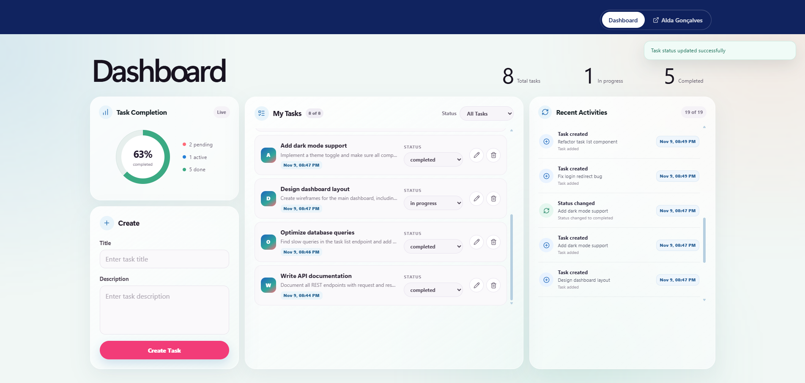

# Task Manager

A full-stack task manager for creating, organizing, and tracking daily work. The application includes status filters, progress metrics, cursor-based pagination, and a recent activity feed.

## Preview




## Features

- Create, edit, delete, and update task status.
- Filter tasks by pending, in-progress, or completed status.
- Track totals and completion progress from the dashboard.
- Review a chronological history of task activity.
- Load tasks and activities incrementally with cursor pagination.
- Display dates and times using the browser's local format.

## Tech Stack

- Next.js and React
- TypeScript
- tRPC
- Zod
- Vitest
- CSS Modules

## Running Locally

Install the dependencies:

```bash
npm install
```

Start the development server:

```bash
npm run dev
```

Open [http://localhost:3000](http://localhost:3000).

## Available Scripts

| Command | Purpose |
| --- | --- |
| `npm run dev` | Start the development server with Turbopack. |
| `npm run build` | Create an optimized production build. |
| `npm start` | Start the production server. |
| `npm run lint` | Check the code with ESLint. |
| `npm test` | Run the test suite once. |
| `npm run test:watch` | Run tests in watch mode. |

## Project Structure

```text
src/
├── app/                         # Pages, layouts, and the tRPC HTTP route
├── components/                  # Shared layout and UI components
├── features/tasks/              # Client-side task components and state
├── server/modules/tasks/
│   ├── domain/                  # Entities, rules, and repository contracts
│   ├── application/             # Task use cases and activity orchestration
│   ├── infrastructure/          # In-memory repository implementations
│   ├── presentation/            # tRPC router and input schemas
│   └── composition/             # Dependency construction
├── server/trpc/                 # Server-side tRPC configuration
└── trpc/                        # Typed browser client
```

## Architectural Decisions

### Layered task module

The task module separates domain rules, application logic, storage, and API concerns. The service depends on repository contracts instead of concrete implementations, which keeps the business logic independent from the current storage choice.

### tRPC at the application boundary

tRPC provides a typed contract between the browser and server. Zod schemas validate incoming data before it reaches the application service, while domain rules remain authoritative when the service is called without the API layer.

### Server-first loading with client interactions

The first dashboard state is loaded on the server to avoid an additional browser request. Task mutations, filtering, and incremental pagination run on the client, followed by a server refresh to keep metrics and recent activity synchronized.

### Cursor-based pagination

Tasks use an opaque keyset cursor based on creation time and ID. Activities use their stable IDs as cursor anchors. This approach avoids page-number drift when records are added or removed between requests.

### In-memory persistence

Repositories currently store data in memory and return defensive copies to protect internal state. A singleton service keeps data available across requests during the same server process, but all data is lost when that process restarts. The repository contracts allow a database implementation to replace the in-memory version later.

### Activity snapshots

Each task change records an activity snapshot containing the task title and timestamp. Historical entries remain meaningful even after a task is renamed or deleted.

## Testing

The Vitest suite covers domain validation, task use cases, repository isolation, pagination behavior, schemas, and the tRPC router.

Run it with:

```bash
npm test
```
